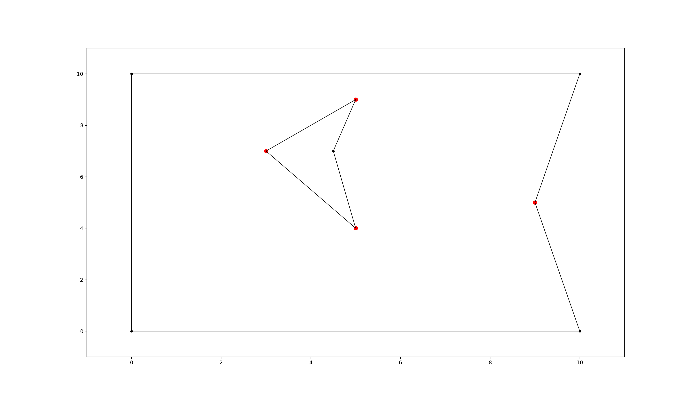
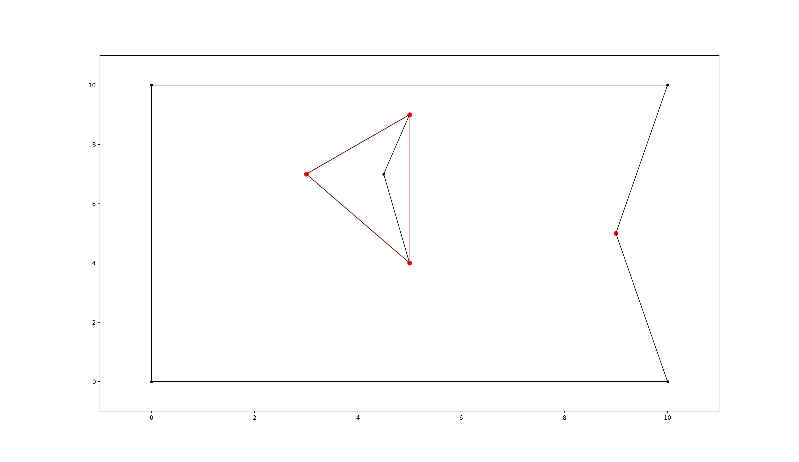
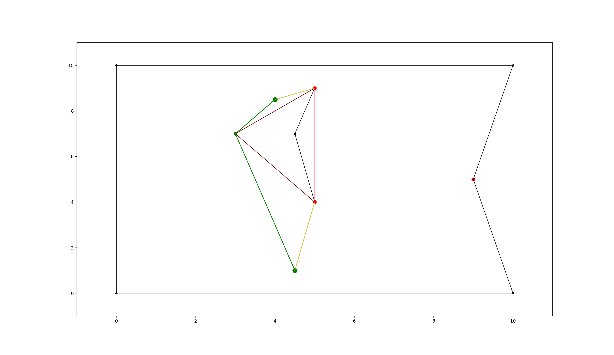
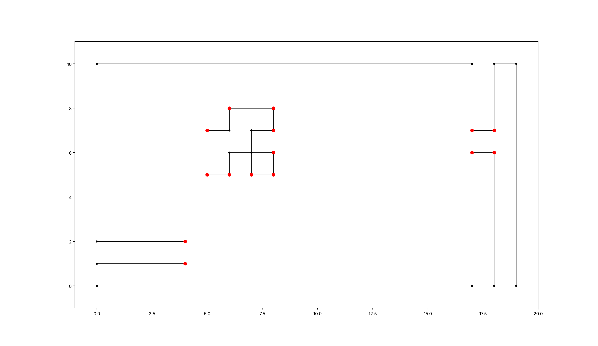

.. _usage:

=====
Usage
=====

.. note::

   Also check out the :ref:`API documentation <api>` or the `code <https://github.com/MrMinimal64/extremitypathfinder>`__.

.. _init:

Initialisation
--------------

Create a new instance of the :ref:`PolygonEnvironment class <env>` from the polygons of the environment.
The environment is initialised in one step and allows fast consecutive shortest path queries.

**Required data format:**
Ensure that all the following conditions on the polygons are fulfilled:

- numpy or python array of coordinate tuples: ``[(x1,y1), (x2,y2,)...]``
- the first point is NOT repeated at the end
- must at least contain 3 vertices
- no consequent vertices with identical coordinates in the polygons (same coordinates in general are allowed)
- a polygon must NOT have self intersections. It may touch itself (identical vertices, a vertex on an edge),
  but must not cross itself there
- no collinear overlapping edges within a polygon (zero-width spikes or slits)
- different polygons may touch or intersect each other
- edge numbering has to follow this convention (for easier computations):
    - outer boundary polygon: counter clockwise
    - holes: clockwise

.. note::

    Simplifying the input geometries (e.g. reducing the number of vertices, smoothing or merging polygons)
    is out of scope of this package. The polygons are used exactly as given.
    If needed, simplify them beforehand, e.g. with the ``simplify()`` method of `Shapely <https://shapely.readthedocs.io/>`__
    (the result must still meet the requirements above).

.. code-block:: python

    # counter clockwise vertex numbering!
    boundary_coordinates = [(0.0, 0.0), (10.0, 0.0), (9.0, 5.0), (10.0, 10.0), (0.0, 10.0)]

    # clockwise numbering!
    list_of_holes = [
        [
            (3.0, 7.0),
            (5.0, 9.0),
            (4.5, 7.0),
            (5.0, 4.0),
        ],
    ]
    from extremitypathfinder import PolygonEnvironment

    environment = PolygonEnvironment(boundary_coordinates, list_of_holes, validate=False)

If there is no explicit boundary polygon, pass ``None`` instead. The environment
is then unbounded, so query points may lie anywhere outside the holes. At least one
hole must be supplied.

.. code-block:: python

    environment = PolygonEnvironment(None, list_of_holes, validate=False)

.. note::

    Pass ``validate=True`` in order to check the condition on the data.
    Raises ``TypeError`` if the input has the wrong type and ``ValueError`` if the input is invalid.

.. note::

    Obstacles (the holes and everything outside the boundary polygon) that touch form a wall:
    a path never passes between two touching polygons, e.g. through a shared vertex or along overlapping edges,
    and never through a point where a polygon touches itself.
    A contact means exactly equal coordinates or a vertex exactly on an edge. Near-contacts (tiny gaps) do not block.
    Cf. :ref:`the edge case of touching obstacles <touching>`.

    polygon environment with extremities marked in red

Visibility Graph Pre-computation
--------------------------------

Creating the environment automatically computes the :ref:`visibility graph  <algorithm>` of the environment once.

    polygon environment with optimised visibility graph overlay in red

Query
-----

.. code-block:: python

    start_coordinates = (4.5, 1.0)
    goal_coordinates = (4.0, 8.5)
    path, length = environment.find_shortest_path(start_coordinates, goal_coordinates)

If any start and goal point should be accepted without checking if they lie within the map, set ``verify=False``.
This is required if points lie really close to polygon edges and
"point in polygon" algorithms might return an unexpected result due to rounding errors.

.. code-block:: python

    path, length = environment.find_shortest_path(
        start_coordinates, goal_coordinates, verify=False
    )

    polygon environment with optimised visibility graph overlay. visualised edges added to the visibility graph in yellow, found shortest path in green.

Converting a grid
-----------------

A grid of ``size_x`` times ``size_y`` cells with blocked cells (obstacles) can be converted into a polygon environment.
Coordinates refer to the corners of the grid cells, i.e. cell ``(x, y)`` spans ``[x, x+1] x [y, y+1]``.
The polygons follow the borders of the blocked cells, they are not simplified (no diagonal edges).
Diagonally adjacent blocked cells touch at a corner: paths cannot pass between them (no corner cutting).

.. code-block:: python

    size_x, size_y = 19, 10
    obstacle_iter = [  # (x,y),
        # obstacles changing boundary
        (0, 1),
        (1, 1),
        (2, 1),
        (3, 1),
        (17, 9),
        (17, 8),
        (17, 7),
        (17, 5),
        (17, 4),
        (17, 3),
        (17, 2),
        (17, 1),
        (17, 0),
        # hole 1
        (5, 5),
        (5, 6),
        (6, 6),
        (6, 7),
        (7, 7),
        # hole 2
        (7, 5),
    ]
    environment = PolygonEnvironment.from_grid(size_x, size_y, obstacle_iter)

    grid-like environment converted to a polygon environment with "extremities" marked in red

**Note:** As mentioned in
`[1, Ch. III 6.3] <http://www.cs.au.dk/~gerth/advising/thesis/anders-strand-holm-vinther_magnus-strand-holm-vinther.pdf>`__
in "chessboard-like grid worlds" (many small obstacles have a lot of extremities!)
it can be better to run A* directly on the grid cells,
e.g. with ``networkx.astar_path()`` on a ``networkx.grid_2d_graph()``.

Cache and import the environment
--------------------------------

.. code-block:: python

    environment.export_pickle(path="./pickle_file.pickle")

    from extremitypathfinder import load_pickle

    environment = load_pickle(path="./pickle_file.pickle")

Environments pickled with an incompatible version of this package (e.g. 2.x) cannot be loaded
(``ValueError``): recreate them from their polygons instead.

Plotting
--------

``environment.search()`` performs the same search as ``find_shortest_path()``,
but returns a ``SearchResult`` with the data of the search (e.g. the temporary edges of start and goal and the search graph) in addition to the path and its length.
The functions in ``plotting.py`` plot an environment and the steps of a search:

.. code-block:: python

    from extremitypathfinder.plotting import plot_environment, plot_search

    environment = PolygonEnvironment(boundary_coordinates, list_of_holes, validate=True)
    # the input polygons and the visibility graph
    plot_environment(environment, plotting_dir="path/to/plots")

    result = environment.search(start, end)
    path, distance = result.path, result.length
    # the found path and the search graph
    plot_search(environment, result, plotting_dir="path/to/plots")

Other functions in ``plotting.py`` can be utilised to plot specific parts of an environment (extremities, edges, ...)

Calling extremitypathfinder from the command line
-------------------------------------------------

A command line script is being installed as part of this package.

**Command Line Syntax**:

::

    extremitypathfinder <path2json_file> -s <start> -g <goal>

The ``<start>`` and ``<goal>`` arguments must be passed as two separate float values.

**Example**:

::

    extremitypathfinder ./example.json -s 2.5 3.2 -g 7.9 6.8

This returns ``[(2.5, 3.2), (5.0, 4.0), (7.9, 6.8)] 6.656009823830612``

Please note that this might be significantly slower than using the package directly from within python.
