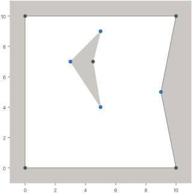
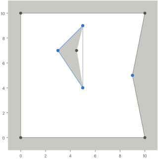
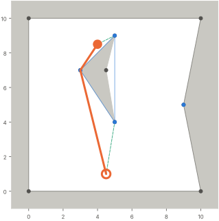
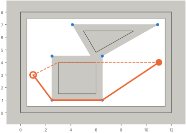
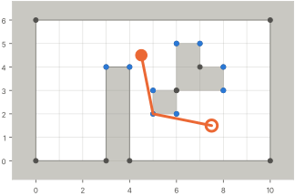
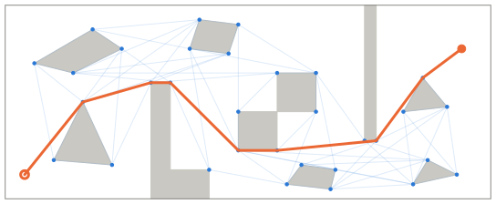

.. _usage:

=====
Usage
=====

.. note::

   Also check out the :ref:`API documentation <api>` or the `code <https://github.com/jannikmi/extremitypathfinder>`__.

.. _init:

Initialisation
--------------

Create a new instance of the :ref:`PolygonEnvironment class <env>` from the polygons of the environment.
The environment is initialised in one step and allows fast consecutive shortest path queries.

**Required data format:**
Ensure that all the following conditions on the polygons are fulfilled:

- numpy or python array of coordinate tuples: ``[(x1,y1), (x2,y2,)...]``
- the first point is NOT repeated at the end
- must at least contain 3 vertices
- no consequent vertices with identical coordinates in the polygons (same coordinates in general are allowed)
- a polygon must NOT have self intersections. It may touch itself (identical vertices, a vertex on an edge),
  but must not cross itself there
- no collinear overlapping edges within a polygon (zero-width spikes or slits)
- different polygons may touch or intersect each other
- the vertex numbering may be clockwise or counter clockwise, also mixed between the polygons.
  Internally the boundary polygon is numbered counter clockwise and the holes clockwise (for easier computations):
  polygons with the opposite numbering are reversed (also in ``environment.boundary_polygon`` and ``environment.holes``)
- the boundary polygon need not be convex: pass a non-convex area (e.g. a geofence) directly as the boundary,
  instead of its convex hull with the difference as holes

.. note::

    Coordinates are planar (Cartesian): path lengths are Euclidean distances in the units of the coordinates.
    Longitude and latitude are angles, so using them directly gives wrong distances and paths
    (one degree of longitude is shorter than one degree of latitude, except at the equator).
    Project geographic data into a projected coordinate system first, e.g. UTM or another local
    projection with `pyproj <https://pyproj4.github.io/pyproj/>`__, and transform the path back afterwards.

.. note::

    Simplifying the input geometries (e.g. reducing the number of vertices, smoothing or merging polygons)
    is out of scope of this package. The polygons are used exactly as given.
    If needed, simplify them beforehand, e.g. with the ``simplify()`` method of `Shapely <https://shapely.readthedocs.io/>`__
    (the result must still meet the requirements above).

.. code-block:: python

    # the boundary polygon (clockwise or counter clockwise vertex numbering)
    boundary_coordinates = [(0.0, 0.0), (10.0, 0.0), (9.0, 5.0), (10.0, 10.0), (0.0, 10.0)]

    # the holes (obstacles)
    list_of_holes = [
        [
            (3.0, 7.0),
            (5.0, 9.0),
            (4.5, 7.0),
            (5.0, 4.0),
        ],
    ]
    from extremitypathfinder import PolygonEnvironment

    environment = PolygonEnvironment(boundary_coordinates, list_of_holes, validate=False)

If there is no explicit boundary polygon, pass ``None`` instead. The environment
is then unbounded, so query points may lie anywhere outside the holes. At least one
hole must be supplied.

.. code-block:: python

    environment = PolygonEnvironment(None, list_of_holes, validate=False)

.. note::

    Pass ``validate=True`` in order to check the condition on the data.
    Raises ``TypeError`` if the input has the wrong type and ``ValueError`` if the input is invalid.

.. note::

    Obstacles (the holes and everything outside the boundary polygon) that touch form a wall:
    a path never passes between two touching polygons, e.g. through a shared vertex or along overlapping edges,
    and never through a point where a polygon touches itself.
    A contact means exactly equal coordinates or a vertex exactly on an edge. Near-contacts (tiny gaps) do not block.
    Cf. :ref:`the edge case of touching obstacles <touching>`.

    polygon environment: obstacles in grey, polygon vertices in grey, extremities in blue

Visibility Graph Pre-computation
--------------------------------

Creating the environment automatically computes the :ref:`visibility graph  <algorithm>` of the environment once.

    polygon environment with the optimised visibility graph in blue

Query
-----

.. code-block:: python

    start_coordinates = (4.5, 1.0)
    goal_coordinates = (4.0, 8.5)
    path, length = environment.find_shortest_path(start_coordinates, goal_coordinates)

If any start and goal point should be accepted without checking if they lie within the map, set ``verify=False``.
This is required if points lie really close to polygon edges and
"point in polygon" algorithms might return an unexpected result due to rounding errors.

.. code-block:: python

    path, length = environment.find_shortest_path(
        start_coordinates, goal_coordinates, verify=False
    )

    the search: the temporary edges connecting start and goal to the visibility graph dashed in green, the shortest path in orange

Shapely and GeoJSON input
-------------------------

Obstacles given as `Shapely <https://shapely.readthedocs.io/>`__ geometries or GeoJSON can be passed directly
to ``PolygonEnvironment.from_shapely()``. It requires Shapely:

.. code-block:: console

    pip install "extremitypathfinder[shapely]"

The geometries are converted into the coordinate input described above,
which gives the same environment as the equivalent coordinate lists:

- the exterior ring of the boundary polygon becomes the boundary, its interior rings become holes.
  Pass ``None`` as the boundary for an unbounded environment.
- the exterior rings of the obstacles become holes. Obstacles may be polygons, multi-polygons,
  geometry collections of polygons or lists of these.
- interior rings of obstacles (e.g. islands in a lake) are ignored with a warning:
  the free space inside an obstacle cannot be reached from the outside.
- the repeated closing vertex of the rings and repeated consecutive vertices are removed,
  a third (z) coordinate is ignored.
- GeoJSON-like mappings (geometries, features, feature collections) and objects with a ``__geo_interface__``
  (e.g. GeoPandas geometries) are accepted as well.

.. code-block:: python

    import shapely
    from extremitypathfinder import PolygonEnvironment

    boundary = shapely.Polygon([(0, 0), (10, 0), (10, 10), (0, 10)])
    obstacles = shapely.MultiPolygon(
        [
            shapely.Polygon([(2, 2), (4, 2), (4, 4), (2, 4)]),
            shapely.Polygon([(6, 6), (8, 6), (8, 8), (6, 8)]),
        ]
    )
    environment = PolygonEnvironment.from_shapely(boundary, obstacles, validate=True)
    path, length = environment.find_shortest_path((1, 1), (9, 9))
    line = shapely.LineString(path)  # the path as a Shapely geometry

With ``validate=True``, the converted coordinates are checked with the same validation as the coordinate input.
Shapely's own validity rules differ (e.g. a polygon touching itself at a vertex is valid here, but not in Shapely).
Geometries rejected by the validation can often be repaired with Shapely before passing them,
e.g. with ``shapely.make_valid()``, which splits a self-intersecting polygon into valid parts:

.. code-block:: python

    obstacle = shapely.Polygon([(2, 2), (4, 4), (4, 2), (2, 4)])  # crosses itself
    obstacles = shapely.make_valid(obstacle)  # two touching triangles
    environment = PolygonEnvironment.from_shapely(boundary, obstacles, validate=True)

The repaired geometry may contain lines or points (e.g. from a zero-width spike):
keep only the polygons, e.g. with ``shapely.make_valid(obstacle, method="structure")``, and check the result.

.. _clearance:

Agent clearance
---------------

The shortest paths touch the corners of the obstacles and run along their edges.
An agent with an extent (a robot, a vehicle, a ship, a game character) has to keep a minimum distance to the obstacles.
Plan in the configuration space: shrink the boundary and inflate the obstacles by the clearance (e.g. the agent radius)
with Shapely, then find the shortest path for a point, which keeps the clearance to the original obstacles:

.. code-block:: python

    from shapely import Polygon, union_all
    from extremitypathfinder import PolygonEnvironment

    boundary_coordinates = [(0.0, 0.0), (12.0, 0.0), (12.0, 8.0), (0.0, 8.0)]
    list_of_hole_coordinates = [
        [(3.0, 1.5), (6.0, 1.5), (6.0, 4.0), (3.0, 4.0)],
        [(6.0, 4.8), (9.0, 6.5), (5.0, 6.5)],
    ]
    clearance = 0.5
    boundary = Polygon(boundary_coordinates).buffer(-clearance, join_style="mitre")
    obstacles = union_all(
        [
            Polygon(hole).buffer(clearance, join_style="mitre")
            for hole in list_of_hole_coordinates
        ]
    )
    environment = PolygonEnvironment.from_shapely(boundary, obstacles, validate=True)
    path, length = environment.find_shortest_path((1.0, 3.0), (11.0, 4.0))
    # length: 11.908... (without clearance: 10.236...)

    the inflated obstacles and the shrunk boundary in grey, the original polygons outlined.
    The passage between the obstacles is narrower than twice the clearance and closes:
    the path with clearance (orange) goes around the obstacle, the path without clearance (dashed) passes through

The join style decides how the corners are inflated:

- **mitre** (recommended): the edges are moved outwards and the corners stay sharp.
  An inflated corner is one vertex, so the environment keeps its size.
  The clearance is kept exactly, also with a ``mitre_limit`` (which cuts very sharp corners at a distance of
  ``mitre_limit`` times the clearance, adding one vertex).
  The corners are inflated more than necessary: paths around them are slightly longer than the shortest paths
  with clearance, and passages narrower than about twice the clearance may close.
- **round** (Shapely's default): close to the exact configuration space, so the paths are nearly the shortest ones.
  But every arc is approximated with many vertices, and all of them become extremities:
  the visibility graph and the preparation time grow considerably (in the example above 113 instead of 6 extremities).
  The arcs are approximated from inside, so the path comes slightly closer than the clearance.
  Lower ``quad_segs`` for fewer vertices, and add a small margin to the clearance where it must be kept.
- **bevel**: cuts the corners with one edge (two vertices per corner).
  Cutting a corner with the interior angle :math:`\alpha` lets the path come as close as
  :math:`\text{clearance} \cdot \sin(\alpha / 2)` to it, e.g. :math:`0.71 \cdot \text{clearance}` at right angles.

Further points:

- Inflated obstacles may overlap each other and the shrunk boundary, ``union_all()`` merges them into one geometry.
  Overlapping and touching polygons are accepted as input and block paths, so merging is optional.
- The shrunk boundary may split into several parts (a ``MultiPolygon``), but ``from_shapely()`` accepts only one
  boundary polygon. Paths cannot leave a part, so use the part containing the start,
  e.g. ``next(part for part in boundary.geoms if part.contains(shapely.Point(start)))``.
- Start and goal must lie outside the inflated obstacles and inside the shrunk boundary:
  otherwise the agent does not fit there, and the search raises a ``ValueError``.
  Check them with ``environment.within_map()``.
- For a different clearance, create a new environment.

Converting a grid
-----------------

A grid of ``size_x`` times ``size_y`` cells with blocked cells (obstacles) can be converted into a polygon environment.
Coordinates refer to the corners of the grid cells, i.e. cell ``(x, y)`` spans ``[x, x+1] x [y, y+1]``.
The polygons follow the borders of the blocked cells, they are not simplified (no diagonal edges).
Diagonally adjacent blocked cells touch at a corner: paths cannot pass between them (no corner cutting).

.. code-block:: python

    size_x, size_y = 10, 6
    obstacle_iter = [  # blocked cells (x, y)
        # a wall at the border of the grid
        (3, 0),
        (3, 1),
        (3, 2),
        (3, 3),
        # an L-shaped obstacle
        (6, 3),
        (6, 4),
        (7, 3),
        # a cell touching the L-shape at a corner (diagonally adjacent)
        (5, 2),
    ]
    environment = PolygonEnvironment.from_grid(size_x, size_y, obstacle_iter)
    path, length = environment.find_shortest_path((7.5, 1.5), (4.5, 4.5))
    # path: [(7.5, 1.5), (5.0, 2.0), (4.5, 4.5)], length: 5.099...

    the grid converted to a polygon environment: the blocked cells in grey, the extremities in blue.
    The path does not pass between the diagonally adjacent cells, it goes around the single cell

**Note:** As mentioned in
`[1, Ch. III 6.3] <http://www.cs.au.dk/~gerth/advising/thesis/anders-strand-holm-vinther_magnus-strand-holm-vinther.pdf>`__
in "chessboard-like grid worlds" (many small obstacles have a lot of extremities!)
it can be better to run A* directly on the grid cells,
e.g. with ``networkx.astar_path()`` on a ``networkx.grid_2d_graph()``.

Cache and import the environment
--------------------------------

.. code-block:: python

    environment.export_pickle(path="./pickle_file.pickle")

    from extremitypathfinder import load_pickle

    environment = load_pickle(path="./pickle_file.pickle")

Environments pickled with an incompatible version of this package (e.g. 2.x) cannot be loaded
(``ValueError``): recreate them from their polygons instead.

Plotting
--------

The plotting functions in ``extremitypathfinder.plotting`` require Matplotlib (``pip install matplotlib``).
All of them use the same drawing:

- ``draw()`` draws an environment and a path onto Matplotlib axes
- ``draw_search()`` draws the result of ``environment.search()`` onto Matplotlib axes
- ``plot_environment()`` and ``plot_search()`` export these drawings as files

``draw()`` returns the axes: the figure can be adjusted and saved in any format:

.. code-block:: python

    import matplotlib.pyplot as plt

    from extremitypathfinder.plotting import PlotStyle, draw

    path, length = environment.find_shortest_path(start_coordinates, goal_coordinates)
    fig, ax = plt.subplots()
    # the obstacles, the visibility graph, the extremities and the path
    draw(environment, path, ax=ax)
    ax.set_axis_off()
    fig.savefig("path.svg")

    # without the visibility graph, all vertices marked, in other colors
    draw(environment, path, graph=False, vertices=True, style=PlotStyle(path_color="black"))

The elements are drawn with group ids (``boundary``, ``obstacles``, ``visibility-graph``, ``extremities``, ``path``, ...),
which are kept in SVG exports, e.g. for styling them with CSS.
The image at the top of this documentation and all other figures are made this way (``scripts/docs_figures.py``).

    the image made with ``draw()``: obstacles in grey, vertices in grey, extremities and the visibility graph in blue,
    the shortest path in orange

``environment.search()`` performs the same search as ``find_shortest_path()``,
but returns a ``SearchResult`` with the data of the search (e.g. the temporary edges of start and goal and the search graph)
in addition to the path and its length.
``draw_search()`` draws the found path and the temporary edges (dashed). Start and goal are marked even when there is no path.
``draw_search(environment, result, path=False)`` shows the search graph without the path.

``plot_environment()`` and ``plot_search()`` export a drawing into a folder and return the path of the file:

.. code-block:: python

    from extremitypathfinder.plotting import plot_environment, plot_search

    # the environment, its visibility graph and extremities
    plot_environment(environment, plotting_dir="path/to/plots")

    result = environment.search(start_coordinates, goal_coordinates)
    # the search: additionally the temporary edges of start and goal and the path
    plot_search(environment, result, plotting_dir="path/to/plots", file_name="search.png")

By default the files are named ``environment_<timestamp>.svg`` and ``search_<timestamp>.svg``,
the extension of ``file_name`` selects another format.

Calling extremitypathfinder from the command line
-------------------------------------------------

A command line script is being installed as part of this package.

**Command Line Syntax**:

::

    extremitypathfinder <path2json_file> -s <start> -g <goal>

The ``<start>`` and ``<goal>`` arguments must be passed as two separate float values.

**Example**:

::

    extremitypathfinder ./example.json -s 2.5 3.2 -g 7.9 6.8

This returns ``[(2.5, 3.2), (5.0, 4.0), (7.9, 6.8)] 6.656009823830612``

Please note that this might be significantly slower than using the package directly from within python.
