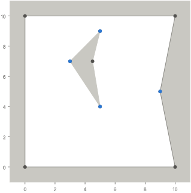
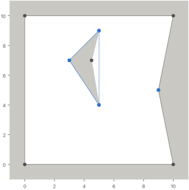
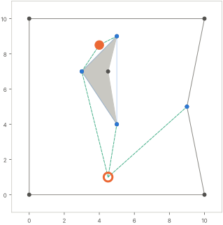
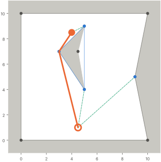
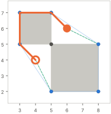
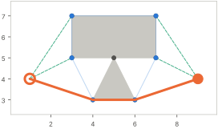
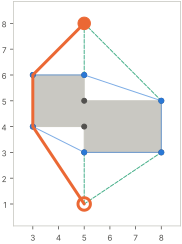

=====
About
=====

.. include:: ./badges.rst

python package for fast geometric shortest path computation in 2D multi-polygon or grid environments based on visibility graphs.

.. image:: _static/demo.svg
    :alt: shortest path through a polygon environment

Also see:
`GitHub <https://github.com/jannikmi/extremitypathfinder>`__,
`PyPI <https://pypi.python.org/pypi/extremitypathfinder/>`__

License
-------

``extremitypathfinder`` is distributed under the terms of the MIT license
(see `LICENSE <https://github.com/jannikmi/extremitypathfinder/blob/master/LICENSE>`__).
The A* search (``utils.astar_path()``) is adapted from ``networkx`` and distributed under its 3-clause BSD license
(see `LICENSES/networkx.txt <https://github.com/jannikmi/extremitypathfinder/blob/master/LICENSES/networkx.txt>`__).

Basic Idea
----------------

Well described in `[1, Ch. II 3.2] <http://www.cs.au.dk/~gerth/advising/thesis/anders-strand-holm-vinther_magnus-strand-holm-vinther.pdf>`__:

An environment ("world", "map") of a given shortest path problem can be represented by one boundary polygon with holes (themselves polygons).

**IDEA**: Two categories of vertices/corners can be distinguished in these kind of environments:

* protruding corners (hereafter called **"Extremities"**)
* all others

    polygon environment: obstacles in grey, polygon vertices in grey, extremities in blue

Extremities have an inner angle (facing towards the inside of the environment) of > 180 degree.
As long as there are no obstacles between two points present, it is obviously always best (=shortest) to move to the goal point directly.
When obstacles obstruct the direct path (goal is not directly 'visible' from the start) however, extremities (and only extremities!) have to be visited to reach the areas "behind" them until the goal is directly visible.

**Improvement:** As described in `[1, Ch. II 4.4.2 "Property One"] <http://www.cs.au.dk/~gerth/advising/thesis/anders-strand-holm-vinther_magnus-strand-holm-vinther.pdf>`__ during preprocessing time the visibility graph can be reduced further without the loss of guaranteed optimality of the algorithm:
Starting from any point lying "in front of" an extremity ``e``, such that both adjacent edges are visible, one will never visit ``e``, because everything is reachable on a shorter path without ``e`` (except ``e`` itself). An extremity ``e1`` lying in the area "in front of"
extremity ``e`` hence is never the next vertex in a shortest path coming from ``e``. And also in reverse: when coming from ``e1`` everything else than ``e`` itself can be reached faster without visiting ``e1``. -> ``e`` and ``e1`` do not have to be connected in the graph.

.. _algorithm:

Algorithm
=========

This package pretty much implements the Visibility Graph Optimized (VGO) Algorithm described in `[1, Ch. II 4.4.2] <http://www.cs.au.dk/~gerth/advising/thesis/anders-strand-holm-vinther_magnus-strand-holm-vinther.pdf>`__, just with a few computational tweaks:

Rough Procedure:
________________

- **1. Preprocessing the environment:** Independently of any query start and goal points the optimized visibility graph is being computed for the static environment once. Later versions might include a faster approach to compute visibility on the fly, for use cases where the environment is changing dynamically. The edges of the precomputed graph between the extremities are shown in blue in the following plots. Notice that the extremity on the right is not connected to any other extremity due to the above mentioned optimisation:

    polygon environment with the optimised visibility graph in blue

- **2. Including start and goal:** For each shortest path query the start and goal points are being connected to the internal graph depending on their visibility. The precomputed graph stays unchanged:

    optimised visibility graph with start (ring) and goal (disk) and their temporary edges, dashed in green

- **3. A-star shortest path computation :** Finding the shortest path on graphs is a standard computer science problem. This package uses ``A*`` with the euclidean distance as heuristic on the precomputed graph extended by start and goal. When the goal is directly visible from the start, the direct connection is returned without a graph search.

    the shortest path in orange, found on the visibility graph extended by the temporary edges of start and goal

.. _touching:

Edge Case: Touching Obstacles
_____________________________

Obstacles are the holes and everything outside the boundary polygon.
**Obstacles that touch form a wall**: a path never passes between two obstacles that touch,
and never through a point where an obstacle touches itself.
Every kind of contact blocks:

- polygons sharing a vertex (identical coordinates)
- a vertex of one polygon lying on an edge of another polygon
- polygons with overlapping collinear edges
- a hole touching the boundary polygon (vertex or edge)
- a polygon touching itself (identical vertices, a vertex on one of its own edges)
- in grids: diagonally adjacent blocked cells (no corner cutting)

Paths may still run along obstacle edges and through the vertices of a single obstacle,
shortest paths hug the obstacles.
At a contact point the obstacles leave one or more "free wedges" (angle ranges of free space).
A path may touch a contact point from one free wedge, but must enter and leave through the same wedge.
Query points (start and goal) lying exactly on a contact point may use any of its free wedges.
Query points lying on an edge shared by two touching obstacles lie inside a wall: there is no path.
Overlapping polygons (intersecting areas) act as their union,
e.g. a hole outside of the boundary polygon touching it has no effect.

A contact means exactly equal coordinates, or a vertex lying exactly on an edge:
the cross product of the vectors from the vertex to the two edge vertices is exactly 0
(exact for coordinates whose products have no rounding errors, e.g. integers),
or the angle representations of the edge vertices seen from the vertex differ by exactly 180 degree
(the computation used by the point in polygon test).
Rays with exactly the same direction (e.g. along overlapping edges of different length) are treated as one ray.
Obstacles with a tiny gap in between (near-contacts) do not touch, paths can pass through the gap.
Contacts of rounded coordinates might hence not be detected,
use identical coordinates for touching polygons.

The following examples have no boundary polygon (unbounded environments), only touching holes:

    the shortest path goes around the holes, it does not pass through the shared vertex

    the tip of the triangle touches the edge of the rectangle: the shortest path goes around the triangle

    the shortest path goes around the holes, it does not run along the shared part of their edges

Supported Geometry and Validation
_________________________________

Polygon coordinates may use any finite scale supported by double-precision floating point numbers.
Nearly collinear vertices are supported, but callers should avoid differences smaller than the
precision available at their coordinate magnitude. The vertices may be ordered clockwise or
counter clockwise (polygons are reversed into the internal convention: boundary counter clockwise,
holes clockwise). Polygons need at least three vertices, must not
self-intersect, and must not repeat a vertex immediately (including repeating the first vertex at
the end). Coordinates must be finite and polygons must have non-zero area. When ``validate=True``,
violations of these input requirements raise ``TypeError`` or ``ValueError`` before preprocessing.

Geometry simplification is out of scope: the polygons are used exactly as given (grids are converted
into polygons following the borders of the blocked cells). Simplify the input beforehand if fewer
vertices are needed, e.g. with Shapely.

Polygons may touch each other and themselves: identical vertices, vertices on edges and overlapping
edges are allowed. Touching obstacles block paths (cf. above). A single polygon touching itself
must not cross itself there: with ``validate=True`` a vertex lying on another edge of the same polygon
with its neighbours on opposite sides of that edge, identical vertices whose corners interleave
and collinear overlapping edges within the same polygon (zero-width spikes or slits) raise a ``ValueError``.
Different polygons may intersect each other.

Implementation
==============

How the steps are implemented (the visibility computation, the free wedges at the vertices,
the graph reduction and the search) and why: cf. the :ref:`engineering design <design>`.

Alternatives
------------

Other packages for shortest paths in polygon environments and how they differ: cf. :ref:`alternatives <alternatives>`.

Contact
--------

Tell me if and how your are using this package. This encourages me to develop and test it further.

Most certainly there is stuff I missed, things I could have optimized even further or explained more clearly, etc.
I would be really glad to get some feedback.

If you encounter any bugs, have suggestions etc. do not hesitate to **open an Issue** or **add a Pull Requests** on Git.
Please refer to the :ref:`contribution guidelines <contributing>`

References
----------------

[1] Vinther, Anders Strand-Holm, Magnus Strand-Holm Vinther, and Peyman Afshani. `"Pathfinding in Two-dimensional Worlds" <http://www.cs.au.dk/~gerth/advising/thesis/anders-strand-holm-vinther_magnus-strand-holm-vinther.pdf>`__. no. June (2015).

Further Reading
----------------

Paper about Lee's algorithm: http://www.dav.ee/papers/Visibility_Graph_Algorithm.pdf

C implementation of Lee's algorithm: https://github.com/davetcoleman/visibility_graph

Acknowledgements
----------------

Thanks to:

- `Georg Hess <https://github.com/georghess>`__ for improving the package in order to allow intersecting polygons.
- `Ivan Doria <https://github.com/idoria75>`__ for adding the command line interface.
