.. _speed-tests:

Performance
===========

.. benchmark-derived: what Numba costs. Update this text with every full benchmark run
   (docs/contributing/performance.md, "After a full run").

This page compares ``extremitypathfinder`` with `pyvisgraph <https://github.com/TaipanRex/pyvisgraph>`__,
the closest alternative (see :ref:`alternatives`), on realistic maps of increasing size.
``extremitypathfinder`` is compared with Numba, its best case, and is also measured without Numba:
Numba is optional, and it costs memory.

The results come from one full run on the machine stated in :ref:`benchmark-results`.
The raw results of that run are in ``benchmarks/results/benchmark.json``.
How everything is measured, and what limits the comparison, is described in :ref:`benchmark-method`.
All of it is reproducible with one command (see :ref:`running-benchmarks`).

Strengths, weaknesses and limitations
-------------------------------------

Written from the measured data of this run.

.. benchmark-derived: the take-aways of the results. Update this text with every full benchmark run
   (docs/contributing/performance.md, "After a full run").

Strengths of ``extremitypathfinder``:

- **Faster preprocessing and queries.** It builds the environment several times faster on all maps both packages
  built within the budget. On the maps where both packages return valid paths, it also answers queries several times
  faster (median). Both ratios grow with the size of the map.
- **Correct paths.** All its paths are valid and agree in length with the valid paths of pyvisgraph.
  On larger maps pyvisgraph returned paths through land (cf. :ref:`benchmark-correctness`).
- **The graph reduction pays off at query time.** Its visibility graph has several times fewer edges than
  pyvisgraph's full visibility graph, and the difference grows with the size of the map.
  The queries search this smaller graph.
- **Larger maps within the budget.** It built maps for which pyvisgraph exceeded the build budget.
- **Less retained memory.** On every map its prepared environment keeps less memory than pyvisgraph's,
  and the difference grows with the size of the map.
- **Fast without Numba too.** Without Numba, builds take more than twice as long and queries moderately longer.
  It is still faster than pyvisgraph, and it built the same maps within the budget.
  The baseline drops by more than half, the retained memory stays the same.
  When to install without Numba: see :ref:`with-or-without-numba`.

Weaknesses and limitations:

- **The preprocessing limits the map size.** The build time grows steeply with the map,
  and the sweep ends where it exceeds the build budget (cf. the build table).
  Going from the coarse 110m data (up to 2k vertices) to the finer source data adds many polygons,
  and the visibility graph grows much faster than the number of vertices there.
- **Memory on small maps.** Its peak above the baseline is close to pyvisgraph's on small maps, despite the lower
  retained memory: the build needs temporary data. On large maps the peak is much lower than pyvisgraph's.
  Its baseline is much larger, so its process needs several times as much memory in total on the smallest maps.
  The gap shrinks with the size of the map.
  Most of the difference in the baseline is Numba (which is optional, cf. the baselines without input data).
- **Query time grows with the map.** Connecting start and goal to the graph checks the visibility of all vertices
  (cf. :ref:`design`).
- **Scope of the comparison.** One machine, single-threaded (pyvisgraph can build its graph with several processes,
  which was not measured). Longitude and latitude are used as
  planar coordinates, and the query points keep a distance from the coasts.

.. _benchmark-results:

Results
-------

.. include:: ../benchmarks/results/benchmark_system.rst

.. include:: ../benchmarks/results/benchmark_limits.rst

Speed
~~~~~

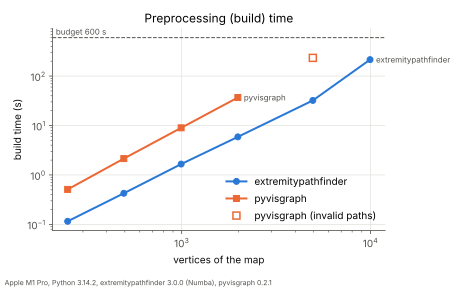

   Build (preprocessing) time. The dashed line is the budget.

.. include:: ../benchmarks/results/benchmark_build.rst

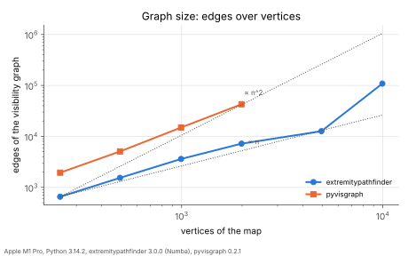

   Amount of work: edges of the visibility graph. ``extremitypathfinder`` keeps only the extremities as nodes and
   only the edges between them; ``pyvisgraph`` connects every vertex. The dotted lines show linear and quadratic growth.

.. benchmark-derived: the comparison of the cost per edge. Update this text with every full benchmark run
   (docs/contributing/performance.md, "After a full run").

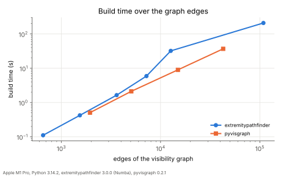

   Build time over the edges of the graph (see the table below for the time per edge).
   Graphs with invalid edges are left out. Where both graphs are valid (up to 2,000 vertices),
   the build time per edge of the two packages is about the same:
   the lower build time of ``extremitypathfinder`` comes from the smaller graph, not from a cheaper edge.

.. include:: ../benchmarks/results/benchmark_graph.rst

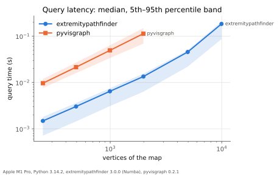

   Query latency: median and 5th to 95th percentile band.

.. include:: ../benchmarks/results/benchmark_query.rst

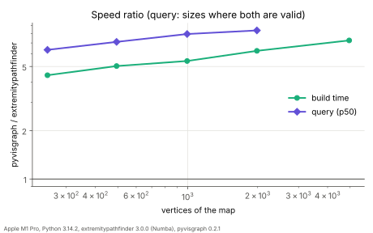

   Speed ratio pyvisgraph / extremitypathfinder: build time for the sizes where both completed the build,
   query time for the sizes where both are valid.

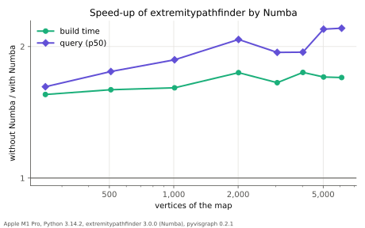

   Speed-up of ``extremitypathfinder`` by Numba: time without Numba / with Numba.

Complexity terms
~~~~~~~~~~~~~~~~

.. benchmark-derived: the comparison of the complexity terms with the measured times. Update this text with every
   full benchmark run and with every change of the complexities
   (docs/contributing/performance.md, "After a full run"; the terms are defined in ``benchmarks/complexity.py``).

The ``O(...)`` terms of the two packages, evaluated for the vertices ``n``, extremities ``m`` and graph edges ``E``
of every map (without constant factors), and compared with the measured times.
In the figures, a line is the term times one constant per package, fitted at the smallest map:
if a line follows its markers, the measured time grows like the term.

- ``extremitypathfinder`` (typical case, :ref:`design <design>`): build ``m n log n + n²``,
  query ``n log n + m + E log E``.
- ``pyvisgraph``: build ``n² log n`` (Lee's algorithm; the implementation takes ``n³`` in the worst case, dotted line),
  query ``2 n log n + E log n`` (two visibility sweeps and a Dijkstra search with a heap).

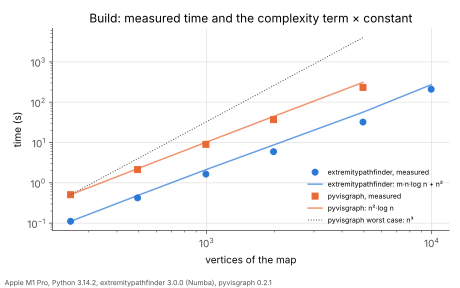

   Build time (markers) and complexity term times a constant (lines).

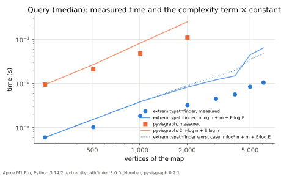

   Median query time (markers) and complexity term times a constant (lines).

.. include:: ../benchmarks/results/benchmark_complexity.rst

What this shows:

- The shapes agree: the measured times grow about like the terms. The build of ``pyvisgraph`` has the slope
  of ``n² log n``, not that of its ``n³`` worst case (the dotted line starts at the same point, only the slopes
  can be compared). The build of ``extremitypathfinder`` grows slightly slower than its term
  (the term is the typical case, an upper estimate here).
- The terms alone do not explain the difference between the packages. They predict a build advantage of
  ``extremitypathfinder`` of 1.2 to 1.5 and a query advantage of 2.4 to 4.4, the measured ratios are
  4.6 to 7.2 for the build and 6.6 to 8.4 for queries. The constant factors are not part of ``O(...)``:
  most of the practical difference comes from the implementation (vectorised, optionally compiled code
  against pure Python), the rest from the smaller graph.

Limitations:

- The terms are models without constants. The constant per package is fitted at its smallest map,
  so the lines say how the work grows, not how fast an implementation is.
- Build: the maps where the package completed the build (also with invalid paths, the time is valid).
  Query: only the maps with valid paths, because the edges of an invalid graph are wrong:
  ``pyvisgraph`` has no valid query result above 2,000 vertices.
- The terms of ``pyvisgraph`` are derived from its algorithm and its source (version 0.2.1),
  the query term (a heap based Dijkstra search and two single-point sweeps) is not stated by its authors.
- The terms of ``extremitypathfinder`` are the typical case. They are defined in ``benchmarks/complexity.py``
  and have to be updated when the complexities change.
- The map with 9,952 vertices comes from a different data set (50 m) than the smaller ones (110 m):
  its point is not a continuation of the others.

Memory
~~~~~~

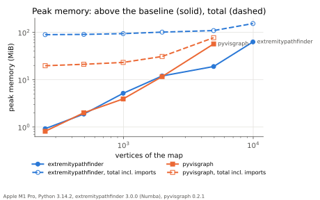

   Peak memory of the build and the queries: above the baseline (solid) and the total including the imports
   and the warm-up (dashed).

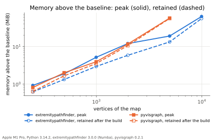

   Above the baseline: the peak (solid) and what is retained after the build (dashed).
   The difference is temporary data of the build and the queries, and memory the allocator keeps.

.. include:: ../benchmarks/results/benchmark_memory.rst

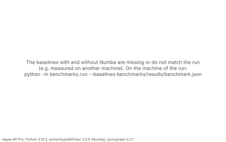

   What the peak memory consists of (the totals of the table).
   Numba is the difference of ``extremitypathfinder``'s baselines with and without Numba (without input data),
   the rest of the baseline is the interpreter, the imports and the input.
   The data parts are measured with Numba: a build without Numba may peak differently.

.. _benchmark-correctness:

Correctness
-----------

Invalid, crashed and over budget runs are listed here. The query times of invalid runs are left out of the results,
their build results are shown (graph size marked as invalid):

.. include:: ../benchmarks/results/benchmark_correctness.rst

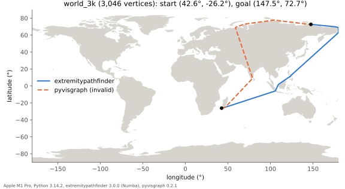

   The paths of both packages for one query on the smallest map with an invalid path (if any).

The causes of the invalid paths and of the build crash of pyvisgraph are described in :ref:`pyvisgraph-defects`.
