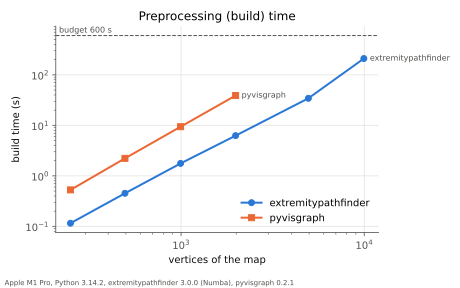
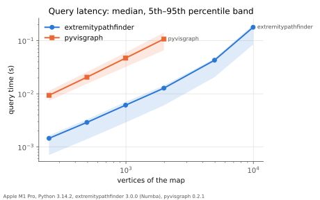
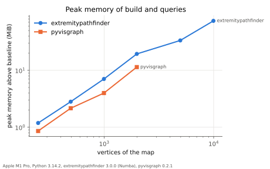
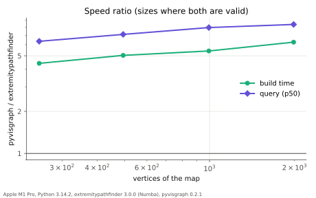
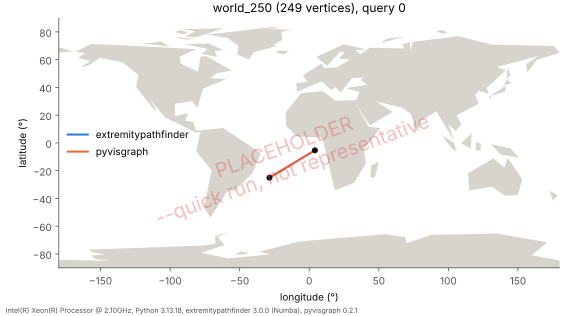

Performance
===========

This section compares ``extremitypathfinder`` with `pyvisgraph <https://github.com/TaipanRex/pyvisgraph>`__,
the closest alternative (see :ref:`alternatives`), on realistic maps of increasing size.
Everything is reproducible with one command (see :ref:`running-benchmarks`); the code is in ``benchmarks/``.

.. warning::

   The result tables and figures below are **placeholders**. They were generated by the real benchmark pipeline
   from a ``--quick`` run (two small maps, 20 queries) on a shared, noisy virtual machine
   to show the format of the results. They are not representative and must not be cited.
   The full run on a stated, otherwise idle machine is pending.

.. _speed-tests:

Method
------

Common input semantics
~~~~~~~~~~~~~~~~~~~~~~

The packages solve the same problem only on a subset of the inputs. All benchmark maps stay inside this subset:

* **Unbounded maps, obstacles only.** pyvisgraph has no boundary polygon.
  ``extremitypathfinder`` is used with ``boundary_coordinates=None``.
* **Simple, pairwise disjoint polygons.** Touching obstacles form a wall in ``extremitypathfinder``.
  pyvisgraph merges vertices with identical coordinates into one graph node and its behaviour at contacts is undefined.
* **No nearly identical vertices.** They crash the pyvisgraph build (see :ref:`benchmark-correctness`).
* **Query points strictly in free space**, at least 0.1° away from every polygon.
  On an edge, the two packages define "inside" differently.

Maps with a boundary polygon, grids and touching or intersecting obstacles are supported by ``extremitypathfinder`` only
and are not benchmarked.

Workload: the world map
~~~~~~~~~~~~~~~~~~~~~~~

pyvisgraph's own documentation computes ocean routes on world shorelines.
The benchmark uses a comparable, freely redistributable dataset:
the `Natural Earth <https://www.naturalearthdata.com>`__ land polygons (public domain, release ``v5.1.2``,
SHA-256 verified), the land masses as obstacles and the sea as free space.

* **Cleaning** (``benchmarks/world_map.py``): multipolygons are split and lakes dropped,
  the coordinates snapped to a 1e-4° grid (about 11 m) without consecutive duplicates,
  self-touching polygons repaired with a 1e-4° buffer,
  and the smaller polygon of any intersecting or touching pair dropped.
  Every map is checked with Shapely: simple polygons, pairwise disjoint.
* **Size sweep**: Douglas-Peucker simplification (``preserve_topology=True``) to a target number of vertices
  (within 2 %), from the coarsest Natural Earth resolution with enough vertices:
  250, 500, 1k, 2k, 5k (the raw 110m data), 10k, 20k, 50k, 100k, 200k and 400k vertices.
  This keeps realistic geometry, a realistic distribution of obstacle sizes and narrow passages at every size.
* **Queries**: one shared set of 200 seeded random point pairs for all sizes and both packages,
  so query latencies are directly comparable across the sweep.
  The points are uniform over longitude [-180, 180] and latitude [-60, 75]
  and at least 0.1° away from the land of every map of the sweep.
  A path always exists (unbounded free space, disjoint obstacles).
* **Limitations**: longitude and latitude are used as planar coordinates.
  Distances are not geodesic and paths do not wrap around the antimeridian (like pyvisgraph's own example).
  Both packages solve the same planar problem, so the comparison is fair, but the routes are not real shipping routes.
  The query points keep a distance from the coasts, which is less representative of near-coast queries.

.. include:: ../benchmarks/results/benchmark_workloads.rst

Measurements
~~~~~~~~~~~~

* **extremitypathfinder with Numba, warmed up**: an environment is built and queried in the same process
  before timing starts. Compilation and import times are excluded.
  pyvisgraph is pure Python. Both run single-threaded (pyvisgraph ``workers=1``).
* **Build (preprocessing) time**: wall time of ``PolygonEnvironment(None, holes)``
  and ``VisGraph().build(polygons, workers=1)``.
  One build per package and size. Builds under 1 s are repeated until 5 s or 5 runs and the minimum is reported.
* **Query latency**: ``time.perf_counter_ns`` per query on the prepared environment (p50, p95, p99, mean, queries/s).
  ``extremitypathfinder`` is queried with ``verify=False``: pyvisgraph does not check the query points either.
* **Peak memory**: peak memory of the subprocess doing the build and the queries,
  reset after the imports, the warm-up and loading the input, minus its baseline at that point.
  Linux: peak resident memory (``VmHWM``), macOS: peak physical footprint (``proc_pid_rusage``,
  the memory figure of the Activity Monitor). A coarse figure: the allocator keeps freed memory.
* **Graph size**: nodes and edges of ``extremitypathfinder``'s reduced visibility graph
  and of pyvisgraph's full visibility graph.
* **Budget**: 10 min per build. Each package and size runs in its own subprocess, which is killed when the build
  exceeds the budget. The sizes run in ascending order. Once a package exceeds the budget it is not run at larger sizes,
  and the sweep ends when ``extremitypathfinder`` exceeds it. Data points beyond the budget are left out:
  no extrapolation.
* **Validation** of every path of both packages, independent of both with Shapely, before any timing is accepted:
  the path starts at the start point, ends at the goal and no segment runs through the interior of an obstacle
  (along edges and through vertices is allowed), and the lengths of both packages agree within a relative
  tolerance of 1e-9. Packages and sizes failing a query are ``invalid`` and left out of the speed results.

Results
-------

.. include:: ../benchmarks/results/benchmark_system.rst

.. include:: ../benchmarks/results/benchmark_limits.rst

   Build (preprocessing) time. The dashed line is the budget.

.. include:: ../benchmarks/results/benchmark_build.rst

   Query latency: median and 5th to 95th percentile band.

.. include:: ../benchmarks/results/benchmark_query.rst

   Peak memory of the build and the queries.

   Speed ratio pyvisgraph / extremitypathfinder, for the sizes where both are valid.

Strengths, weaknesses and limitations
~~~~~~~~~~~~~~~~~~~~~~~~~~~~~~~~~~~~~

*Pending the full run.* This part is written from the measured data only, assuming no speedup in advance.
One trade-off to check: ``extremitypathfinder`` reduces the visibility graph to the extremities and the edges
which can be part of a shortest path, which may pay off at query time.

.. _benchmark-correctness:

Correctness
-----------

Invalid, crashed and over budget runs are listed here instead of in the speed results:

.. include:: ../benchmarks/results/benchmark_correctness.rst

   The paths of both packages for one query on the smallest map with an invalid path (if any).

Known pyvisgraph 0.2.1 defects
~~~~~~~~~~~~~~~~~~~~~~~~~~~~~~

Found by the validation while preparing the benchmark, reproducible with
``python -m benchmarks.pyvisgraph_issues``:

**Paths through obstacles.** On the cleaned 110m world map (4,954 vertices),
the query from the North Sea (3, 56) to the South China Sea (105, 5) returns a path of length 150.26
with two segments across land: Lisbon to Valencia across Iberia and Algeria to Bab-el-Mandeb across Africa.
The valid shortest path (``extremitypathfinder``) has length 211.14, around the Cape of Good Hope.
14 of the 277,886 edges of pyvisgraph's visibility graph of this map run through land.

All of them connect two vertices of the same polygon whose midpoint lies level with another vertex of that polygon.
pyvisgraph rejects such an edge by a point-in-polygon test of its midpoint
(a crossing count along a horizontal ray, ``polygon_crossing``), which mixes exact and tolerant comparisons:
edges are skipped with exact comparisons of the y-coordinates, but a vertex counts as lying on the ray
when the cross product rounds to zero (absolute tolerance 1e-10 with a ray of length 10\ :sup:`4`).
In exact arithmetic the midpoint lies level with the vertex, in floating point it misses it by a rounding error,
e.g. ``(0.1 + 0.7) / 2 == 0.39999999999999997``.
One of the two edges at that vertex is then skipped and the other one treated as touching the ray:
the crossing is lost, the midpoint is classified as outside and the edge through the obstacle is kept.
Coordinates on a decimal grid (snapped data, rounded or integer coordinates) make such coincidences frequent.
A consistent half-open crossing rule (an edge counts when ``(a.y > p.y) != (b.y > p.y)``
and the ray hits it at the exact x of the intersection) classifies the midpoints as inside and rejects all 14 edges.
The smallest example is a single polygon with six vertices:

.. code-block:: python

    import pyvisgraph as vg

    polygon = [(0.0, 0.1), (2.0, -1.0), (3.0, 0.4), (2.0, 2.0), (0.0, 0.7), (-1.0, 0.4)]
    graph = vg.VisGraph()
    graph.build([[vg.Point(*p) for p in polygon]])
    graph.shortest_path(vg.Point(-0.1, -0.3), vg.Point(-0.1, 1.1))
    # [Point(-0.10, -0.30), Point(0.00, 0.10), Point(0.00, 0.70), Point(-0.10, 1.10)]
    # through the polygon from (0, 0.1) to (0, 0.7).
    # extremitypathfinder: around the vertex (-1, 0.4), length 2.28
    # with the half-open crossing rule, pyvisgraph returns the same path

**Build crash on nearly identical vertices.** Two vertices about 1e-6 apart
(in the raw Natural Earth 110m data near (-122.85, 76.12) in the Canadian Arctic) make ``angle2``
compute a cosine of -1.0000000014: the side opposite the angle is 1e-6 long and the law of cosines cancels.
The truncation ``int(cos * 1e10) / 1e10`` keeps it below -1 and ``acos`` raises ``ValueError: math domain error``.
Two valid, disjoint triangles of that data suffice (found by removing vertices); the build crashes within milliseconds:

.. code-block:: python

    import pyvisgraph as vg

    polygons = [
        [(137.51176, 75.94917), (138.831075, 76.13676), (141.471615, 76.09289)],
        [(-121.499995, 75.900019), (-122.854924, 76.116543), (-122.854925, 76.116543)],
    ]
    vg.VisGraph().build([[vg.Point(*p) for p in polygon] for polygon in polygons])
    # ValueError: math domain error

Clamping the cosine to [-1, 1], as proposed upstream in pull request #33 of pyvisgraph, makes the build succeed.
The benchmark maps avoid the crash by snapping to a grid.

.. _running-benchmarks:

Running the benchmarks
----------------------

.. code-block:: sh

    # full run: hours, on an otherwise idle machine
    uv run --all-extras --group benchmark python -m benchmarks.run
    # smoke test of the harness (seconds): python -m benchmarks.run --quick
    make benchmark

``--quick`` uses two small maps and 20 queries, writes its tables and figures to the gitignored
``benchmarks/results/raw/quick/`` and treats a failed download of the map data as a warning.
Other options: ``--sizes 250,1k,5k`` (the query set is generated for the maps of the run:
compare only runs with the same sizes), ``--budget`` (seconds per build), ``--query-limit`` (seconds per package and size),
``--queries``, ``--seed`` and ``--packages``.
The Natural Earth data and the generated maps are cached in ``benchmarks/data/``.
The raw results (JSON, with the hardware, the exact versions, the git commit, the command line, the budgets,
the seeds and the query set) are written to ``benchmarks/results/raw/``,
the tables to ``benchmarks/results/`` and the figures to ``docs/_static/``.
``--render-only RAW_JSON`` renders the tables and figures again from raw results.

Full run on a laptop
~~~~~~~~~~~~~~~~~~~~

1. Connect the power adapter, close other applications and keep the lid open
   (a closed MacBook sleeps without an external display).
2. Check the machine: ``uv run --all-extras --group benchmark python -m benchmarks.run --preflight``.
   It checks that Numba is active, that the peak memory measurement is correct on this machine
   and the power source, and it downloads the data and generates the maps (minutes, cached).
3. Start the full run (command above). On macOS it keeps the machine awake with ``caffeinate``
   while it runs. A measurement during which the machine slept anyway is repeated
   (the monotonic clocks of the timings stop during sleep, the wall clock does not).
4. After an interruption (Ctrl-C, crash, restart), continue with the same command and ``--resume``.
   The raw results are written after every measurement: the finished measurements are kept,
   the interrupted one is repeated. Resuming refuses changed settings, versions or a different machine.
   ``--fresh`` starts over. An existing run is never overwritten without one of the two options.

``scripts/speed_benchmarks.py`` measures ``extremitypathfinder`` alone on the small test environments
with the same harness.
