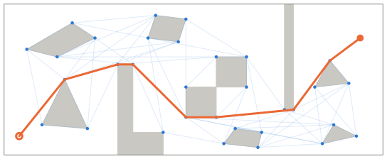

===================
extremitypathfinder
===================

.. include:: ./badges.rst

Python package for fast geometric shortest path computation in 2D multi-polygon or grid environments
based on visibility graphs.

.. code-block:: python

    from extremitypathfinder import PolygonEnvironment

    # a complete example: cf. Getting Started
    environment = PolygonEnvironment(boundary_coordinates, list_of_holes)
    path, length = environment.find_shortest_path(start_coordinates, goal_coordinates)

Features
--------

- **Exact shortest paths**: the Euclidean shortest path between any two points of the free space,
  not an approximation on a grid or mesh.
- **Fast repeated queries**: the visibility graph of an environment is computed once,
  each query then only connects its start and goal to it.
  Only the protruding corners ("extremities") become graph nodes, which keeps the graph small.
- **Polygon environments**: a boundary polygon with holes, or holes only (unbounded environments).
  Polygons may touch and overlap each other. :ref:`Touching obstacles <touching>` form a wall that paths cannot pass.
- **Grids**: convert a grid with blocked cells into a polygon environment.
- **Few dependencies**: NumPy and NetworkX. Optional `Numba <https://numba.pydata.org/>`__ acceleration.
- **Extras**: input validation, plotting (Matplotlib), caching environments with pickle,
  and a command line interface.

Where to start
--------------

- New to the package? :ref:`Getting started <getting_started>` shows the installation and a first example,
  :ref:`Usage <usage>` explains all features.
- Upgrading from version 2.x? Follow the :ref:`upgrade guide <upgrading>`.
- Curious how it works? :ref:`About <algorithm>` gives an illustrated overview,
  the :ref:`engineering design <design>` describes the architecture and the algorithms.
- Looking for a specific function? See the :ref:`API reference <api>`.
- Want to contribute? Read the :ref:`contribution guidelines <contributing>`.

.. toctree::
   :maxdepth: 1
   :caption: User Guide

    Getting Started <0_getting_started>
    Usage <1_usage>
    Upgrading from 2.x <2_upgrading>
    API <4_api>

.. toctree::
   :maxdepth: 1
   :caption: Background

    About <3_about>
    Engineering Design <8_design>
    Performance <7_performance>

.. toctree::
   :maxdepth: 1
   :caption: Development

    Contributing <5_contributing>
    Changelog <6_changelog>

Indices and tables
------------------

* :ref:`genindex`
* :ref:`modindex`
* :ref:`search`
